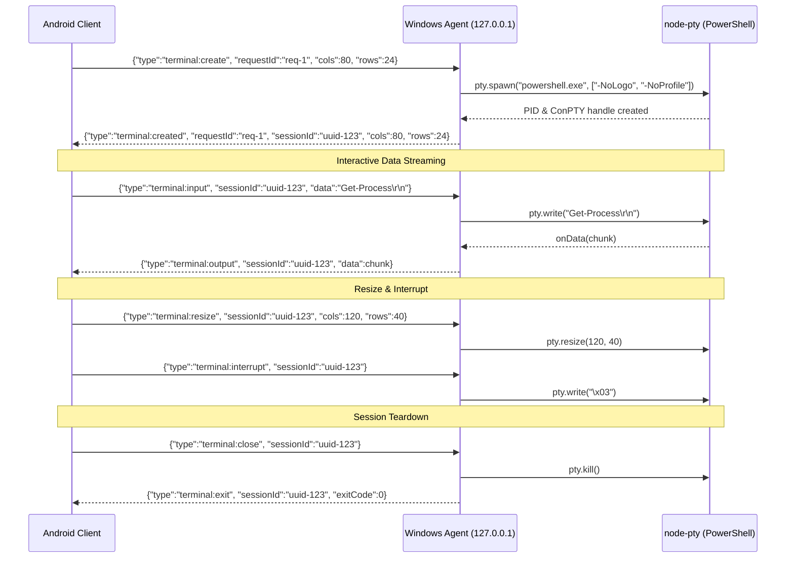

# LazyTerminal Architecture Specification

## 1. System Overview

**LazyTerminal** is an open-source remote terminal system designed to allow users to securely control interactive Windows PowerShell sessions from an Android phone, both locally and remotely, without requiring a self-hosted VPS or central relay.

```
+-------------------------------------------------------------------+
|                        LazyTerminal Monorepo                      |
|                                                                   |
|   +-----------------------+              +--------------------+   |
|   |      apps/android     |              | apps/windows-agent |   |
|   |  React Native + Expo  |              | Node.js + ConPTY   |   |
|   |   (xterm.js WebView)  |              |  (PowerShell.exe)  |   |
|   +-----------+-----------+              +---------+----------+   |
|               |                                    |              |
|               |        WebSocket Transport         |              |
|               +<==================================>+              |
|                             JSON Protocol                         |
|                                   ^                               |
|                                   |                               |
|                         +---------+----------+                    |
|                         |  packages/protocol |                    |
|                         | Zod Schemas & Types|                    |
|                         +--------------------+                    |
+-------------------------------------------------------------------+
```

---

## 2. Core Components

### 2.1 Shared Protocol (`packages/protocol`)
- **Single Source of Truth**: All messages exchanged between the client and agent are defined as TypeScript types and validated at runtime using [Zod](https://zod.dev).
- **Discriminated Union**: Messages use a `type` discriminator (e.g., `terminal:create`, `terminal:input`, `terminal:output`, `terminal:resize`, `terminal:interrupt`, `terminal:close`, `ping`, `pong`).
- **Guards & Limits**:
  - Maximum raw WebSocket payload: 128 KB.
  - Maximum input data payload: 64,000 characters per message.
  - Col/Row bounds enforcement: Columns (10–500), Rows (2–200).
  - Identifier length limits: 128 characters max for `sessionId` and `requestId`.

### 2.2 Windows Agent (`apps/windows-agent`)
- **PTY Session Registry**: Creates and manages interactive PowerShell processes using `node-pty` with native Windows ConPTY (`useConpty: true`).
- **Process Isolation**: Each terminal session has its own independent OS process, unique UUID, and environment. Commands or variables set in Session A do not spill into Session B.
- **Signal Handling**: Supports interactive interrupt (`Ctrl+C` / `0x03`) without killing the host shell process.
- **Resource Constraints**: Limits max concurrent sessions (default 10) to prevent denial of service.
- **Loopback Enforcement**: In Milestone 001, the WebSocket server binds strictly to `127.0.0.1` and actively rejects non-loopback socket origins.

### 2.3 Android Mobile Client (`apps/android`)
- **Stack**: React Native with Expo and TypeScript.
- **Terminal Rendering**: xterm.js hosted locally inside an embedded WebView with bidirectional JavaScript messaging to avoid React Native layout re-render bottlenecks.
- **Milestone 001 Scope**: Repository scaffold and protocol bindings.

### 2.4 Integration Test Suite (`tests/integration`)
- Real end-to-end integration tests using Vitest and `ws`.
- Spawns actual PowerShell PTY processes on Windows to verify process lifecycle, variable isolation, Ctrl+C interrupt handling, dynamic resizing, and client disconnection resilience.

---

## 3. Protocol Message Flow

### Session Creation & Lifecycle


---

## 4. Security Principles

1. **Localhost Only in Dev**: In Milestone 001, the agent is strictly bound to `127.0.0.1`. Remote access is deliberately blocked.
2. **Zero Shell Command Interpolation**: Command strings are never passed to `child_process.exec()`. All terminal input is forwarded directly via the PTY stdin stream, preventing shell command injection.
3. **No Terminal I/O Logging**: Terminal keystrokes and stdout/stderr streams are never logged to console or disk by default to prevent accidental credential leakage.
4. **Least Privilege**: The agent should be run as a regular standard Windows user, not elevated Administrator. Arbitrary PowerShell commands execute with the privileges of the logged-in user.

---

## 5. Roadmap

- **Milestone 001 (Completed)**: Monorepo setup, shared protocol with Zod, Windows agent with `node-pty`, unit & Windows integration tests.
- **Milestone 002**: Android mobile application with Expo, multi-tab terminal switching, xterm.js WebView renderer, virtual keyboard toolbar.
- **Milestone 003**: Cryptographic pairing, authenticated connection handshake (mTLS / Noise protocol), reconnection persistence.
- **Milestone 004**: Direct peer-to-peer remote connectivity (WebRTC DataChannels with STUN/TURN, without VPS requirements).
