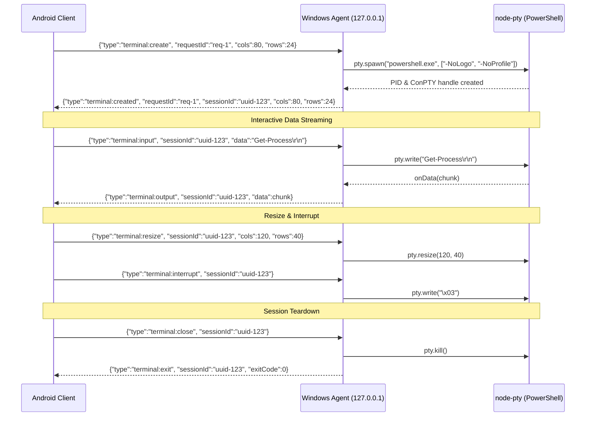

# LazyTerminal Architecture Specification

## 1. System Overview

**LazyTerminal** is an open-source remote terminal system designed to allow users to securely control interactive Windows PowerShell sessions from an Android phone, both locally and remotely, without requiring a self-hosted VPS or central relay.

```
+-------------------------------------------------------------------+
|                        LazyTerminal Monorepo                      |
|                                                                   |
|   +-----------------------+              +--------------------+   |
|   |      apps/android     |              | apps/windows-agent |   |
|   |  React Native + Expo  |              | Node.js + ConPTY   |   |
|   |   (xterm.js WebView)  |              |  (PowerShell.exe)  |   |
|   +-----------+-----------+              +---------+----------+   |
|               |                                    |              |
|               |        WebSocket Transport         |              |
|               +<==================================>+              |
|                             JSON Protocol                         |
|                                   ^                               |
|                                   |                               |
|                         +---------+----------+                    |
|                         |  packages/protocol |                    |
|                         | Zod Schemas & Types|                    |
|                         +--------------------+                    |
+-------------------------------------------------------------------+
```

---

## 2. Core Components

### 2.1 Shared Protocol (`packages/protocol`)
- **Single Source of Truth**: All messages exchanged between the client and agent are defined as TypeScript types and validated at runtime using [Zod](https://zod.dev).
- **Discriminated Union**: Messages use a `type` discriminator (e.g., `terminal:create`, `terminal:input`, `terminal:output`, `terminal:resize`, `terminal:interrupt`, `terminal:close`, `ping`, `pong`).
- **Guards & Limits**:
  - Maximum raw WebSocket payload: 128 KB.
  - Maximum input data payload: 64,000 characters per message.
  - Col/Row bounds enforcement: Columns (10–500), Rows (2–200).
  - Identifier length limits: 128 characters max for `sessionId` and `requestId`.

### 2.2 Windows Agent (`apps/windows-agent`)
- **PTY Session Registry**: Creates and manages interactive PowerShell processes using `node-pty` with native Windows ConPTY (`useConpty: true`).
- **Process Isolation**: Each terminal session has its own independent OS process, unique UUID, and environment. Commands or variables set in Session A do not spill into Session B.
- **Signal Handling**: Supports interactive interrupt (`Ctrl+C` / `0x03`) without killing the host shell process.
- **Resource Constraints**: Limits max concurrent sessions (default 10) to prevent denial of service.
- **Loopback Enforcement**: In Milestone 001, the WebSocket server binds strictly to `127.0.0.1` and actively rejects non-loopback socket origins.

### 2.3 Android Mobile Client (`apps/android`)
- **Stack**: React Native with Expo and TypeScript.
- **Terminal Rendering**: xterm.js hosted locally inside an embedded WebView with bidirectional JavaScript messaging to avoid React Native layout re-render bottlenecks.
- **Milestone 001 Scope**: Repository scaffold and protocol bindings.

### 2.4 Integration Test Suite (`tests/integration`)
- Real end-to-end integration tests using Vitest and `ws`.
- Spawns actual PowerShell PTY processes on Windows to verify process lifecycle, variable isolation, Ctrl+C interrupt handling, dynamic resizing, and client disconnection resilience.

---

## 3. Protocol Message Flow

### Session Creation & Lifecycle


---

## 4. Security Principles

1. **Localhost Only in Dev**: In Milestone 001, the agent is strictly bound to `127.0.0.1`. Remote access is deliberately blocked.
2. **Zero Shell Command Interpolation**: Command strings are never passed to `child_process.exec()`. All terminal input is forwarded directly via the PTY stdin stream, preventing shell command injection.
3. **No Terminal I/O Logging**: Terminal keystrokes and stdout/stderr streams are never logged to console or disk by default to prevent accidental credential leakage.
4. **Least Privilege**: The agent should be run as a regular standard Windows user, not elevated Administrator. Arbitrary PowerShell commands execute with the privileges of the logged-in user.

---

---

## 5. Desktop Terminal Mirroring & Process Discovery (Task 003)

### 5.1 ConPTY Handle Ownership & Multi-Client Mirroring
Windows ConPTY (`CreatePseudoConsole`) creates paired input/output pipes owned by the spawning agent process (`node-pty` in `SessionRegistry`).
- **Handle Ownership**: ConPTY anonymous pipes cannot be directly shared across independent OS processes via handle inheritance once spawned.
- **WebSocket Mirroring Architecture**: Instead of trying to duplicate private OS handles, the LazyTerminal Windows Agent acts as the central session multiplexer:
  - Input from any authenticated client (mobile app or PC viewer CLI) is written to `pty.write()`.
  - PTY output chunks are buffered in a sliding ring (64 KB) in `SessionRegistry` and broadcast to all connected clients attached to that session.
  - When a second client attaches (`session:attach`), it immediately receives the sliding output buffer (`session:attached` with `recentOutput`) to reconstruct the screen.
  - Detaching (`session:detach` or `Ctrl+]` in PC viewer) unbinds the viewer without terminating the background PowerShell process.
  - Only explicit `terminal:close` or shell exit terminates the underlying process.

### 5.2 External Windows Process Discovery & Architectural Boundaries
LazyTerminal can enumerate running Windows terminal processes (`powershell.exe`, `pwsh.exe`, `cmd.exe`, `WindowsTerminal.exe`) via `Get-Process`:
- **Unmanaged Classification**: External processes are classified in `session:list_response` as `managed: false, attachable: false`.
- **Architectural Boundary**: Windows intentionally isolates console handles. Attaching to an already-running external Windows Terminal tab or independent `powershell.exe` window would require:
  1. `AttachConsole(pid)` — Windows allows a process to attach to at most one console at a time, and fails if the target process is not a direct child or if the caller already has a console.
  2. Invasive DLL Injection / API Hooking — Injecting threads into another user process to divert stdout/stdin pipes is blocked by Windows security policies, triggers antivirus / Windows Defender heuristic alerts, and causes shell instability.
- **LazyTerminal Design Decision**: LazyTerminal cleanly respects OS process boundaries. Rather than hacking external processes, LazyTerminal provides a clean, native experience where users spawn and manage isolated ConPTY sessions that can be mirrored on PC and controlled from mobile.

### 5.3 Mobile Rendering Pipeline with `@xterm/xterm` (v6)
Mobile terminal rendering uses official `@xterm/xterm` (v6.0.0, MIT) and `@xterm/addon-fit` bundled completely offline inside the Android WebView:
- **No Hand-Rolled ANSI Parsers**: Full VT100/VT220/VT500 escape sequence processing, PSReadLine cursor positioning, syntax highlighting, and color palettes.
- **Direct Terminal Input**: `term.onData()` forwards keystrokes directly to the agent without duplicate key events or losing backspace/arrow navigation.
- **Tab Preservation**: WebViews remain mounted in the React Native view hierarchy using absolute positioning and opacity toggling, preserving xterm scrollback history and avoiding expensive DOM re-renders upon tab switching.

---

---

## 7. Production Applications & UX Architecture (Task 004)

### 7.1 Android Terminal UX & Scrolling Architecture
- **Touch Gesture Translation**: Terminal scrolling is implemented directly inside the WebView's `#terminal-container` via low-latency touch listeners (`touchstart`, `touchmove`, `touchend`).
- **Momentum Physics**: Flick gestures compute touch velocity and execute smooth exponential decay animation (`lines * 0.92`), providing a native feel.
- **Scrollback Buffer**: Set to 10,000 lines with `scrollOnUserInput: true` to prevent jumpy navigation when inspecting prior command logs.
- **Return to Bottom Floating Action**: When the user scrolls up past 3 lines, a floating badge displays `▼ Return to live output (N lines up)` and instantly jumps to the latest output on tap.
- **Dynamic Font Scaling**: Real-time font size adjustment (`A-` / `A+` controls in the touch toolbar, clamped between 9px and 22px) dynamically updates the xterm CSS and triggers `@xterm/addon-fit` to recalculate grid dimensions.
- **Safe Area Migration**: Replaced deprecated `react-native` `SafeAreaView` with `react-native-safe-area-context` and wrapped the application root in `<SafeAreaProvider>`, eliminating layout warnings across Android edge-to-edge displays.

### 7.2 Existing-Terminal Integration & Safe Migration
- **Technical ConPTY Limitations**: As analyzed in Section 5.2, directly hijacking an already-running external PowerShell process console on Windows is prevented by kernel handle boundaries and requires invasive DLL injection.
- **Safe Directory Migration ("Spawn Managed Session Here")**:
  - The agent queries `Get-Process` to identify external PowerShell, cmd, and Windows Terminal instances.
  - Where accessible, the agent resolves the process's working directory or provides quick spawn actions.
  - The Desktop UI and Android UI offer a 1-click "Spawn Managed Session in Directory" action. This creates a fully managed, isolated LazyTerminal ConPTY session with the identical working environment, allowing instant mobile and PC access without risking the stability of external processes.

### 7.3 Windows Desktop GUI Application (`LazyTerminal.exe`)
- **Native GUI Client**: Packaged into a standalone Windows executable (`LazyTerminal.exe`) using Electron with GitHub-dark aesthetics.
- **Dual Functionality**: Combines a real-time terminal viewer (via `@xterm/xterm`) and a session manager dashboard.
- **Independent Agent Lifecycle**:
  - The background Node.js agent is decoupled from Electron's process tree and can run as an independent detached service.
  - When closing the Desktop GUI, if sessions are active, a confirmation dialog offers:
    - **Keep Agent Running in Background**: Closes the desktop window while keeping the agent and all PowerShell sessions alive for mobile phone access.
    - **Stop Agent & Exit**: Terminates both GUI and background sessions cleanly.
    - **Cancel**: Keeps the desktop window open.
- **One-Click Shortcuts**: Packaging automatically produces `install-shortcuts.ps1` (creates Desktop and Start Menu `.lnk` shortcuts), `uninstall.ps1`, and `Start-LazyTerminal.cmd`.

### 7.4 Standalone Android APK Pipeline
- **EAS Build Configuration (`eas.json`)**: Configured with `preview` and `production` profiles setting `buildType: "apk"` for standalone sideloadable Android packages without Google Play Store signing requirements.
- **Network Permissions**: Configured in `app.json` with `android.permission.INTERNET`, `ACCESS_NETWORK_STATE`, and `usesCleartextTraffic: true` for reliable local LAN Wi-Fi WebSocket connectivity.
- **Self-Contained Bundling**: The entire xterm.js runtime, CSS styling, and addon fit libraries are bundled into offline assets, requiring zero internet access during mobile terminal execution.

---

## 8. Roadmap

- **Milestone 001 (Completed)**: Monorepo setup, shared protocol with Zod, Windows agent with `node-pty`, unit & Windows integration tests.
- **Milestone 002 (Completed)**: Android mobile application with Expo (SDK 57), pairing & authentication flow, multi-tab terminal switching, virtual keyboard toolbar.
- **Milestone 003 (Completed)**: PC terminal mirroring CLI (`pnpm dev:viewer`), session discovery (`session:list`, `session:attach`, `session:detach`), real `@xterm/xterm` v6 offline bundle, multi-client streaming.
- **Milestone 004 (Completed)**: Production Android scrolling UX, font sizing, safe area context, Windows desktop GUI (`LazyTerminal.exe`), background agent lifecycle persistence, external terminal discovery/migration, and standalone APK pipeline.
- **Milestone 005 (Next)**: Direct peer-to-peer remote connectivity (WebRTC DataChannels with STUN/TURN, without VPS requirements).
